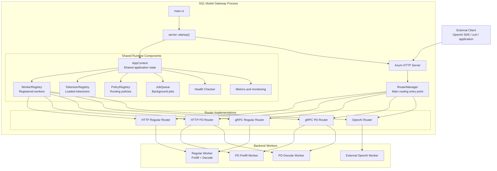
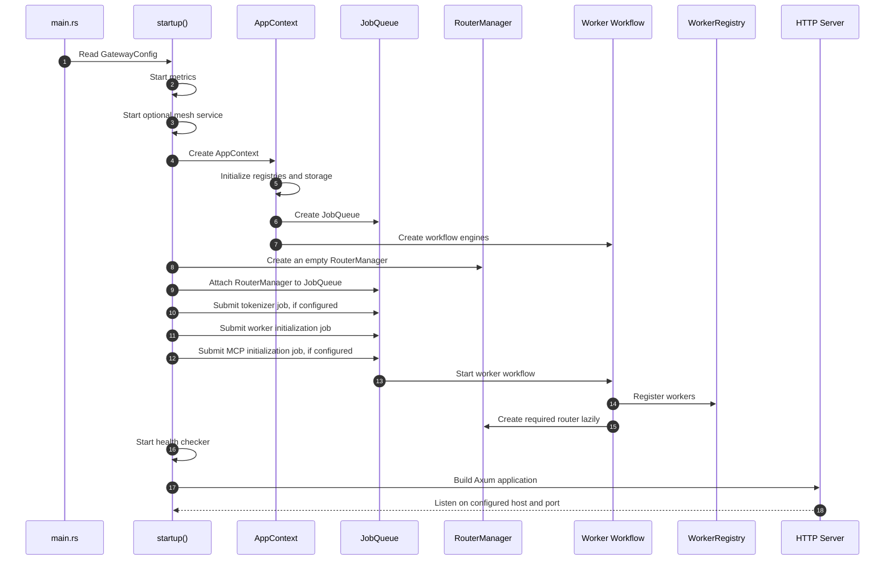
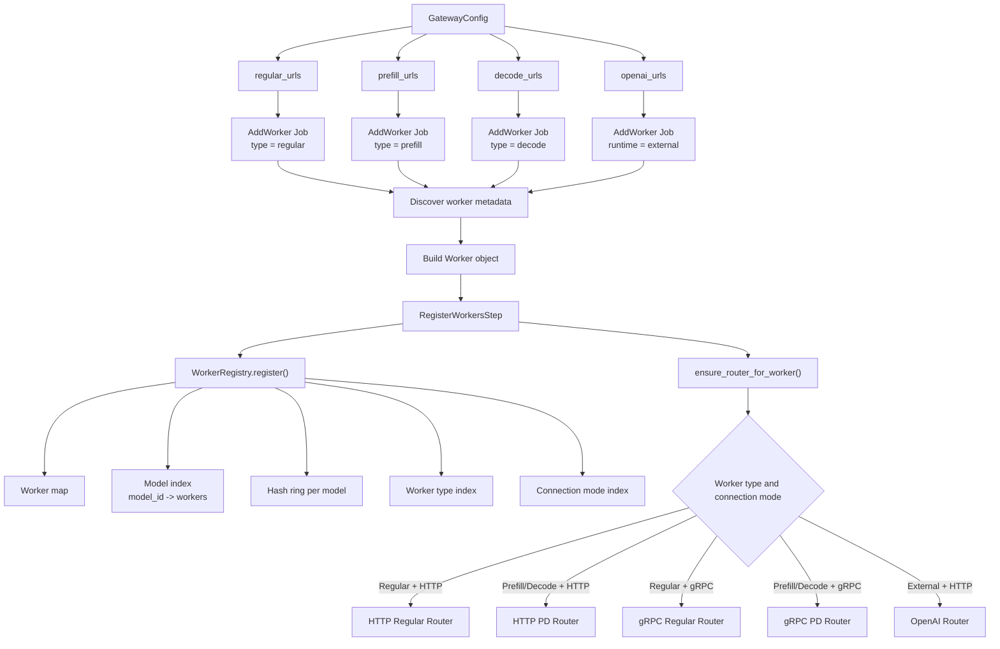
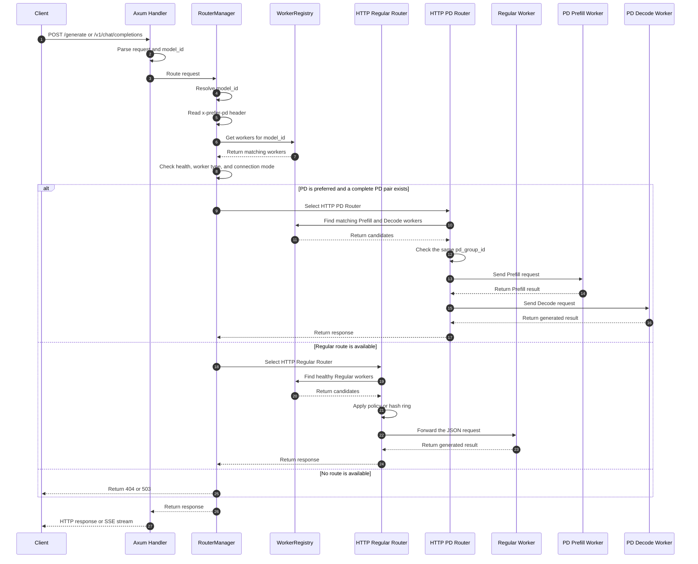
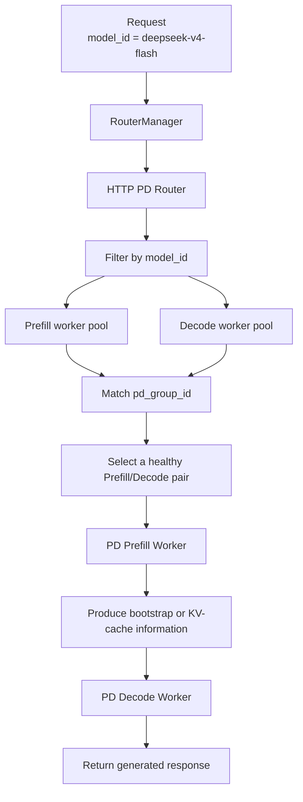

# SGL Model Gateway Server Architecture

This document explains how the SGL Model Gateway server works. It is written for developers who are just starting to understand the project.

The gateway currently supports:

- Multiple models;
- Regular workers and PD workers;
- HTTP and gRPC worker connections;
- OpenAI-compatible external workers;
- The same `model_id` being served by different worker modes;
- Lazy creation of routers after workers are registered.

## 1. High-Level Architecture



The main request path is:

```text
Client request
    -> Axum HTTP Server
    -> RouterManager
    -> Select a router
    -> Select one worker or a PD worker pair
    -> Send the request to the backend
    -> Return the response to the client
```

## 2. Server Startup

Important source files:

- `/Users/dxm/workshop/opensource/sgl-model-gateway/src/main.rs`
- `/Users/dxm/workshop/opensource/sgl-model-gateway/src/server.rs`
- `/Users/dxm/workshop/opensource/sgl-model-gateway/src/app_context.rs`



The important design point is that the `RouterManager` starts empty. Routers are created when the first matching worker is registered.

## 3. Worker Registration

Important source files:

- `/Users/dxm/workshop/opensource/sgl-model-gateway/src/core/job_queue.rs`
- `/Users/dxm/workshop/opensource/sgl-model-gateway/src/core/steps/worker/shared/register.rs`
- `/Users/dxm/workshop/opensource/sgl-model-gateway/src/core/worker_registry.rs`
- `/Users/dxm/workshop/opensource/sgl-model-gateway/src/routers/router_manager.rs`



A worker contains metadata such as:

```json
{
  "url": "http://127.0.0.1:18001",
  "model_id": "deepseek-v4-flash",
  "worker_type": "regular",
  "tokenizer_path": "/models/deepseek-v4-flash"
}
```

`:codex-annotation{index="1"}`

The same model can have multiple worker modes:

```text
deepseek-v4-flash
├── Regular Worker
├── PD Prefill Worker
└── PD Decode Worker
```

All of these workers are stored under the same model index:

```text
WorkerRegistry.model_index["deepseek-v4-flash"]
```

This means that these fields have different meanings:

| Field | Meaning |
|---|---|
| `model_id` | Identifies the model exposed to clients |
| `worker_type` | Identifies Regular, Prefill, or Decode mode |
| `connection_mode` | Identifies HTTP or gRPC communication |
| `runtime_type` | Identifies local or external OpenAI workers |
| `pd_group_id` | Controls which Prefill and Decode workers can be paired |

## 4. Router Types

The router is selected from the worker metadata:

| Worker condition | Router |
|---|---|
| Regular + HTTP | HTTP Regular Router |
| Prefill/Decode + HTTP | HTTP PD Router |
| Regular + gRPC | gRPC Regular Router |
| Prefill/Decode + gRPC | gRPC PD Router |
| External + HTTP | OpenAI Router |

Each router type is normally created once. Multiple workers of the same type are managed through the shared `WorkerRegistry`.

## 5. Request Routing

Important source files:

- `/Users/dxm/workshop/opensource/sgl-model-gateway/src/routers/app.rs`
- `/Users/dxm/workshop/opensource/sgl-model-gateway/src/routers/router_manager.rs`



### Model ID Resolution

The RouterManager resolves the model as follows:

1. If the request contains `model_id`, use it.
2. If no model is specified and only one model is registered, use that model as the default.
3. If multiple models are registered and no model is specified, return `400`.
4. If no workers are registered, return `503`.

### Router Preference

Without `x-prefer-pd: true`, the current preference is:

```text
HTTP Regular
    -> gRPC Regular
    -> HTTP PD
    -> gRPC PD
    -> OpenAI
```

With `x-prefer-pd: true`, the current preference is:

```text
HTTP PD
    -> gRPC PD
    -> HTTP Regular
    -> gRPC Regular
    -> OpenAI
```

The header changes the preference order. It does not bypass health checks or the requirement for a complete PD pair.

## 6. Regular Request Flow

```mermaid
flowchart LR
    Request["Request<br/>model_id = deepseek-v4-flash"]
    Request --> RM["RouterManager"]
    RM --> Router["HTTP Regular Router"]
    Router --> Filter["Filter by model, type, mode, and health"]
    Filter --> Policy["Apply routing policy"]
    Policy --> Worker["Choose Regular Worker"]
    Worker --> Tokenizer["Tokenizer runs inside worker"]
    Tokenizer --> Inference["Prefill + Decode"]
    Inference --> Response["HTTP response or SSE stream"]
```



In HTTP Regular mode:

- The gateway forwards the JSON request;
- The worker performs tokenization;
- The worker performs the complete inference process;
- The gateway returns the worker response to the client;
- Retry and circuit-breaker logic can exclude unhealthy workers.

## 7. PD Request Flow



A valid PD pair must satisfy all of these conditions:

```text
Same model_id
+ Same connection mode
+ Same pd_group_id
+ Healthy Prefill worker
+ Healthy Decode worker
```

Workers from different PD groups must not be paired:

```text
Invalid:
model A / group-1 / prefill
model A / group-2 / decode

Valid:
model A / group-1 / prefill
model A / group-1 / decode
```

## 8. HTTP and gRPC Differences

```mermaid
flowchart LR
    Client["Client request"] --> RM["RouterManager"]
    RM --> HTTP["HTTP Router"]
    RM --> GRPC["gRPC Router"]

    HTTP --> HTTPWorker["HTTP Worker"]
    HTTPWorker --> HTTPTokenizer["Tokenizer inside worker"]
    HTTPTokenizer --> HTTPInference["Worker inference"]

    GRPC --> Registry["Gateway TokenizerRegistry"]
    Registry --> Template["Apply chat template"]
    Template --> Encode["Encode text into token IDs"]
    Encode --> Request["Build gRPC request"]
    Request --> GrpcWorker["gRPC Worker"]
    GrpcWorker --> TokenIDs["Return token IDs"]
    TokenIDs --> Decode["Decode token IDs in gateway"]
    Decode --> Text["Return text response"]
```



### HTTP Workers

```text
Gateway
    -> Forward JSON
    -> Worker tokenizes and runs inference
```

### gRPC Workers

```text
Gateway
    -> Get tokenizer
    -> Apply chat template
    -> Encode text into token IDs
    -> Call gRPC worker
    -> Decode returned token IDs
    -> Build the client response
```

For gRPC routing, the corresponding tokenizer must be available in the `TokenizerRegistry`. Otherwise the request can fail with:

```text
Tokenizer not found for model
```

## 9. Important API and Boundary Notes

The following endpoints already pass the model ID through the main routing path:

```text
/generate
/v1/chat/completions
/v1/completions
/v1/rerank
```

The following areas still need special attention in a multi-model deployment:

```text
/model_info
Some server_info requests
/v1/responses/{response_id}
/v1/responses/{response_id}/cancel
/v1/responses/{response_id}/input_items
```

The PD router also does not currently support every model capability. For example, embeddings and classification may return an unsupported response when routed to PD.

## 10. Summary

```text
model_id
    Identifies the model visible to clients

worker_type
    Identifies Regular, Prefill, or Decode mode

connection_mode
    Identifies HTTP or gRPC communication

runtime_type
    Identifies local or external OpenAI workers

pd_group_id
    Controls valid Prefill/Decode pairing

RouterManager
    Selects the router type

Concrete Router
    Selects the actual worker or PD worker pair
```

For the same model, the current design can expose one public model ID while using different backend modes:

```text
model_id = deepseek-v4-flash

Regular request -> Regular Worker
PD-preferred request -> PD Prefill + Decode Workers
```

The client only needs to know the public model ID. The gateway hides the backend deployment details.
